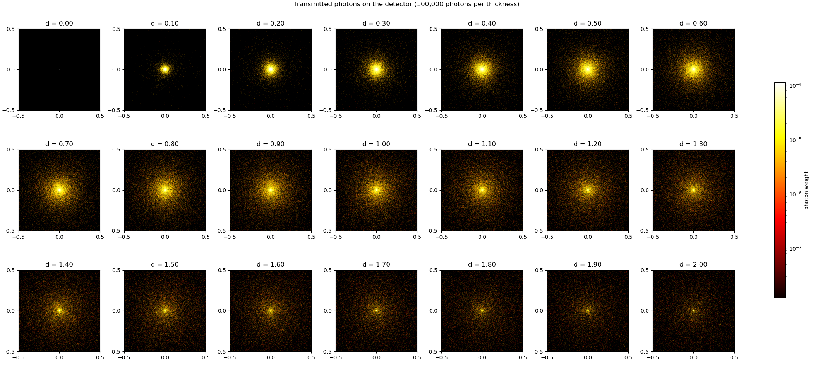
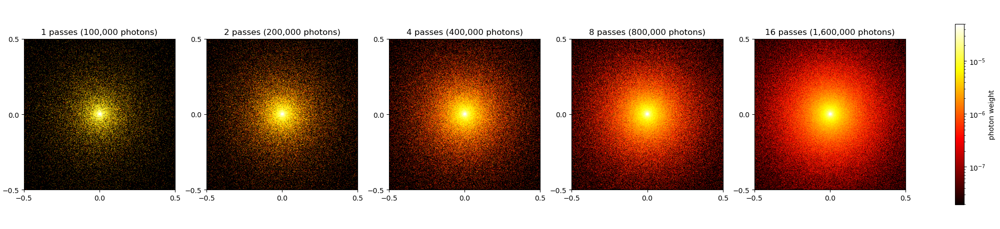

# Photon Monte Carlo

Monte Carlo simulation of photon transport through a homogeneous scattering slab.

A narrow beam of photons enters a slab of thickness $d$. Inside the material the photons are absorbed and scattered. Photons leaving through the bottom surface are recorded on a two-dimensional detector (transmittance $T$), photons leaving through the top surface contribute to the diffuse reflectance $R_d$.

The project implements the algorithm from the Scratchapixel lesson [Monte Carlo Simulation](https://www.scratchapixel.com/lessons/mathematics-physics-for-computer-graphics/monte-carlo-methods-in-practice/monte-carlo-simulation.html) (part of *Monte Carlo Methods in Practice*), rewritten in Python with numpy.



## What was done

The lesson presents the simulation as a C++ program that traces one photon at a time. This project:

1. **Implemented the lesson's algorithm**: free path sampling, photon weights, Russian roulette, Henyey–Greenstein scattering and the direction update (see [Algorithm](#algorithm)).
2. **Rewrote it in Python with numpy.** Instead of a loop over photons, all photons are traced at the same time as arrays (one array element = one photon). Photons that leave the slab or die in Russian roulette are removed from the arrays. 100 000 photons take a fraction of a second.
3. **Fixed issues in the lesson's code** (see [Differences from the lesson](#differences-from-the-lesson)).
4. **Reproduced the lesson's experiments:**
   - detector image of the transmitted light (the diffusion halo around the beam),
   - thickness sweep from $d = 0$ to $d = 2$ in 21 steps, as in the lesson (`plot_thickness.py`),
   - progressive refinement: averaging several independent passes (`plot_passes.py`).
5. **Made the images readable** with a logarithmic colour scale (see [Why a logarithmic colour scale?](#why-a-logarithmic-colour-scale)).

## Algorithm

Every photon packet starts at $(0, 0, 0)$, moving into the slab along $+z$, with weight $w = 1$. It then repeats the following steps until it leaves the slab or is killed.

**1. Free path.** The distance to the next interaction follows the Beer–Lambert law, $p(s) = \sigma_t e^{-\sigma_t s}$ with $\sigma_t = \sigma_a + \sigma_s$. It is sampled by inverting the CDF:

$$s = -\frac{\ln \xi}{\sigma_t}, \qquad \xi \sim U(0, 1)$$

**2. Boundary test.** The distance to the slab surface along the direction $\mu$ is

$$s_b = \frac{d - z}{\mu_z} \ \text{ if } \mu_z > 0, \qquad s_b = -\frac{z}{\mu_z} \ \text{ if } \mu_z < 0$$

If $s > s_b$, the photon is moved to the surface and leaves the slab: through the bottom it adds its weight to $T$ and to the detector cell it hits, through the top it adds its weight to $R_d$.

**3. Absorption.** Otherwise the photon moves by $s$ and loses the absorbed part of its weight:

$$w \leftarrow w \, \frac{\sigma_s}{\sigma_t}$$

**4. Russian roulette.** If $w$ drops below `roulette_threshold`, the photon survives with probability $p$ = `roulette_survival` and its weight becomes $w / p$; otherwise it is killed. On average the weight is preserved ($p \cdot w/p = w$), so the estimate stays unbiased while the walk still ends.

**5. Scattering.** The cosine of the deflection angle is sampled from the Henyey–Greenstein phase function with anisotropy $g$:

$$\cos\theta = \frac{1}{2g}\left[1 + g^2 - \left(\frac{1 - g^2}{1 - g + 2g\xi}\right)^2\right], \qquad \cos\theta = 2\xi - 1 \ \text{ for } g = 0$$

and the azimuth uniformly, $\phi = 2\pi\xi$. The new direction is

$$\mu'_x = \mu_x\cos\theta + \frac{\sin\theta\,(\mu_x\mu_z\cos\phi - \mu_y\sin\phi)}{\sqrt{1 - \mu_z^2}}$$

$$\mu'_y = \mu_y\cos\theta + \frac{\sin\theta\,(\mu_y\mu_z\cos\phi + \mu_x\sin\phi)}{\sqrt{1 - \mu_z^2}}$$

$$\mu'_z = \mu_z\cos\theta - \sqrt{1 - \mu_z^2}\,\sin\theta\cos\phi$$

For $|\mu_z| \approx 1$ the denominator is zero, so these photons use the special case from the lesson: $\mu' = (\sin\theta\cos\phi,\ \pm\sin\theta\sin\phi,\ \pm\cos\theta)$.

## Differences from the lesson

**Fixes to the lesson's code:**

| | lesson | this project | why |
|---|---|---|---|
| absorption | `w -= sigma_a / sigma_t` | `w *= sigma_s / sigma_t` | the absorbed part must be a fraction of the current weight, not a constant |
| weight clamp | `w = std::min(0.0, w)` | not needed | `min` sets the weight to 0 after the first interaction (should be `max`); with multiplication the weight never becomes negative |
| detector bounds check | `x < width` | pixel index `xi < width` | compares a position with a pixel count |
| exit position | position before the last step | position on the slab surface | photons are moved to the boundary before being recorded |
| pixel index | `(int)` cast | `np.floor` | `(int)` rounds towards zero, so photons just outside the left and bottom edges were counted in pixel 0 |
| $\mu_z = 0$ | distance to boundary 0, counted as reflected | distance $\infty$ | a photon moving parallel to the surfaces cannot leave the slab; it keeps scattering |

**Different default parameters:**

| parameter | lesson | this project |
|---|---|---|
| $\sigma_s$ | 2 | 1 |
| detector width | 5 | 1 (zoomed in on the halo) |

The other parameters are the same as in the lesson: 100 000 photons, $\sigma_a = 1$, $g = 0.75$, roulette threshold 0.001, survival probability $1/m = 0.1$ ($m = 10$), and a 512 × 512 detector.

**Not implemented** (also left out by the lesson): specular reflection at the surface, internal reflection (Fresnel equations), and multi-layered materials.

## Requirements

- Python 3.7+
- numpy
- matplotlib 3.5+

```bash
pip install numpy matplotlib
```

## Usage

```bash
git clone <repository-url>
cd PhotonMonteCarlo
```

Run the scripts from the project root. The images are saved to `assets/`.

```bash
python3 plot_thickness.py
```

Generates detector images for slab thicknesses from 0 to 2 (`assets/thickness_grid.png`).

```bash
python3 plot_passes.py
```

Shows the progressive refinement of the detector image at a fixed slab thickness (`assets/passes_grid.png`).

### Using the simulation directly

```python
import numpy as np
from config import Config
from particle import simulate

result = simulate(1.0, Config(), np.random.default_rng())

result.grid            # detector image, shape (height, width)
result.transmittance   # T, fraction of photon weight leaving through the bottom
result.reflectance     # Rd, fraction of photon weight leaving through the top
```

## Progressive refinement

As described in the lesson, each run of the simulation is an independent estimate, so several runs can be averaged to reduce the noise. `plot_passes.py` runs the simulation $M$ times for the same slab thickness, each pass with new random photon paths, and averages the detector images:

$$I_{\text{average}} = \frac{1}{M}\sum_{k=1}^{M} I_k$$

The statistical noise decreases as $1/\sqrt{M}$: 16 passes give about four times less noise than one pass with the same number of photons per pass.



## Configuration

Simulation parameters are defined in the `Config` dataclass in `config.py`.

| Parameter | Default | Description |
|---|---:|---|
| `photons` | 100000 | Number of photon packets per simulation |
| `width` | 512 | Detector width in pixels |
| `height` | 512 | Detector height in pixels |
| `sigma_a` | 1.0 | Absorption coefficient $\sigma_a$ |
| `sigma_s` | 1.0 | Scattering coefficient $\sigma_s$ |
| `g` | 0.75 | Scattering anisotropy, $-1 < g < 1$ ($0$ = isotropic, $> 0$ = mostly forward) |
| `detector_size` | 1.0 | Physical width and height of the square detector, centred on the beam |
| `roulette_threshold` | 0.001 | Weight below which Russian roulette starts |
| `roulette_survival` | 0.1 | Survival probability in Russian roulette ($1/m$ in the lesson) |

The defaults can be changed directly in `config.py` or overridden when creating a configuration object:

```python
settings = Config(
    photons=1_000_000,
    g=0.9,
    sigma_a=0.5,
    sigma_s=1.5,
)
```

Slab thicknesses, the number of passes and the snapshot settings are defined at the top of `plot_thickness.py` and `plot_passes.py`.

## Why a logarithmic colour scale?

The lesson notes that the detector values may need to be scaled to be visible. The reason is the photons that cross the slab without any interaction. By the Beer–Lambert law their fraction is

$$P_{\text{no interaction}} = e^{-\sigma_t d}$$

With the default parameters ($\sigma_t = 2$) this is about 82 % at $d = 0.1$. These photons keep their initial direction and all land in the central detector pixel, which is therefore thousands of times brighter than the scattered halo around it.

On a linear colour scale only that single pixel would be visible. The detector images therefore use a logarithmic colour scale, with the upper limit at the 99.9th percentile of the non-empty pixel values: the scattered distribution becomes visible and the central pixel simply saturates.

## Results

Obtained with the default parameters ($\sigma_a = 1$, $\sigma_s = 1$, $g = 0.75$, 100 000 photon packets):

| Slab thickness $d$ | Transmittance $T$ | Reflectance $R_d$ | Absorbed $1 - T - R_d$ |
|---:|---:|---:|---:|
| 0.0 | 1.000 | 0.000 | 0.000 |
| 0.1 | 0.897 | 0.005 | 0.098 |
| 1.0 | 0.305 | 0.018 | 0.677 |
| 2.0 | 0.084 | 0.019 | 0.897 |

The values are Monte Carlo estimates and vary by about $\pm 0.001$ between runs.

- As $d$ grows, fewer photons reach the bottom surface and more of the weight is absorbed.
- The halo first widens (up to about $d \approx 0.7$), because photons scatter more often before they leave the slab, and then becomes dimmer and noisier, because fewer photons get through.
- $R_d$ stays small: with $g = 0.75$ scattering is mostly forward, so few photons turn back towards the top surface.
- $T + R_d < 1$ because part of the photon weight is absorbed inside the material.

## Files

| File | Purpose |
|---|---|
| `particle.py` | the simulation: `simulate()`, Henyey–Greenstein sampling, scattering, boundaries, detector |
| `config.py` | simulation parameters (`Config`) and the `Result` returned by `simulate()` |
| `plotting.py` | shared plotting helpers: logarithmic colour scale and detector image |
| `plot_thickness.py` | detector images for a range of slab thicknesses |
| `plot_passes.py` | progressive refinement at a single slab thickness |

## References

- Scratchapixel, [Monte Carlo Simulation](https://www.scratchapixel.com/lessons/mathematics-physics-for-computer-graphics/monte-carlo-methods-in-practice/monte-carlo-simulation.html), in *Monte Carlo Methods in Practice*.
- L. Wang, S. L. Jacques, *Monte Carlo Modeling of Light Transport in Multi-layered Tissues in Standard C*, 1992 (MCML). Cited by the lesson as the basis of the algorithm.
